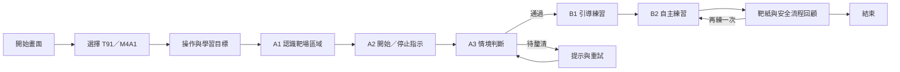

# 高中軍訓虛擬靶場：A＋B 遊戲規畫

## 教材與外觀核對紀錄（2026-10-27）

已閱讀 `book/乙版下冊.pdf` 所收錄第 10 章「射擊預習與實作」，共 26 頁，課本印刷頁碼 172–197。後續設計以此章的用語、安全情境與課程順序為教材依據。

- 第 172–177 頁：T91 介紹、左右視圖、外觀部位辨識與操作安全。
- 第 178–188 頁：姿勢與要領介紹、瞄準教材、練習活動與自我檢核。
- 第 189–195 頁：靶場安全、場地分區、人員職責、防護裝備與指示流程。
- 第 196–197 頁：心得回顧與問答。

`T91-遊戲畫面示意.png` 的槍枝未準確呈現 T91，僅保留作場景及介面氣氛參考，不能作為槍型或瞄具製作依據。T91 模型需以課本第 174–175 頁的左右視圖核對護板、提把、瞄具、槍托及整體輪廓；不得直接將 M4A1 改名為 T91。

後續 A 關卡需涵蓋裝備、場地分區與指示理解；B 的場景、鏡頭高度及口令用語須重新對照教材，不沿用目前概念圖直接定稿。

## B 場景與靶紙樣式（2026-10-27 確認）

- **場景**：依課本第 190–191 頁，以臺灣戶外靶場為視覺參考。玩家位於有遮蔽的固定射擊位置；正前方依序呈現射擊線、開闊靶道、編號目標區與後方擋彈土堤。等待、預備及安全相關區域可在 A 導覽中呈現，但 B 的第一人稱視角保持單一指定靶道。實際場地配置以課本示意和教師核對為準。
- **紙靶**：B 第一版採原創的白色長方形紙靶、中央深色同心圓與清楚的靶位編號，固定於目標區支架。回顧頁使用同一張靶紙的平面圖顯示遊戲落點。課本第 185 頁為瞄準練習圖、第 190 頁照片可見編號目標區；同心圓紙靶是本遊戲為了便於閱讀落點所做的介面選擇，並非宣稱課本指定靶型或實際訓練標準。
- **舊示意圖**：`T91-遊戲畫面示意.png` 同時存在槍型與室內場景不符之處，不作美術依據。

## 定位與範圍

供高中全民國防教育課堂使用的單人網頁遊戲。每位學生約 10–15 分鐘完成一輪，以紙靶、固定靶位及教師審定的安全指示為核心。第一版包含 A「安全流程闖關」與 B「半寫實靶場練習」；暫不製作教師帶班系統、學生帳號、排名榜或戰鬥關卡。

槍款選單包含 **T91** 與 **M4A1**。M4A1 已有展示用 3D 模型；T91 選用 [中興コンビニ的免費 FBX 素材](https://booth.pm/ja/items/5624286)作為預定來源。該站下載需登入，模型檔尚未取得，故「T91 可選」是遊戲設計需求，不能當作目前可執行功能。導入素材時保留作者、來源及使用條款記錄，並檢查瞄具與貼圖外觀。

## 完整遊戲流程



### A．安全流程闖關：3–5 分鐘

| 階段 | 學生看見與執行 | 系統回饋 | 過關條件 |
|---|---|---|---|
| A1 認識靶場 | 以固定視角觀看靶位、等待區、指示燈與標靶；點選指定區域 | 顯示區域名稱與用途 | 辨識畫面中的靶位、標靶與停止指示 |
| A2 指示練習 | 依畫面上的「等待／開始／停止」狀態，選擇繼續或暫停 | 在停止狀態點擊射擊區時，立即停用操作並說明原因 | 正確回應兩種狀態變化 |
| A3 情境判斷 | 回答 2–3 題圖像式情境，例如指示改變時該如何處理 | 錯誤時說明判斷依據，可立即重試 | 完成全部情境；不以反應速度評分 |

A 的目的在確認學生理解遊戲內的靶場規則。不能跳過 A 直接進入 B；重新遊玩時可提供 30 秒的複習版。題目與用語由授課教師確認。

### B．半寫實靶場練習：6–10 分鐘

| 階段 | 遊戲進行方式 | 主要畫面元素 |
|---|---|---|
| B0 準備 | 選定 T91 或 M4A1；簡短顯示滑鼠操作與練習目標 | 槍款縮圖、開始按鈕、操作提示 |
| B1 引導練習 | 固定靶位，依序提示「觀察指示、進入瞄具視角、對紙靶練習」；首次命中後顯示落點 | 指示燈、紙靶、瞄具視角、提示卡 |
| B2 自主練習 | 兩回合固定紙靶，每回合限定少量練習次數；左鍵射擊、右鍵換彈匣 | 剩餘次數、回合進度、暫停鍵 |
| B3 回顧 | 顯示靶紙落點、前後回合差異、安全流程完成情況及一項下次練習建議 | 靶紙縮圖、簡潔圖表、重試／結束 |

第一版不加入移動目標、倒數壓力或競技排行榜。射擊操作只在畫面顯示「開始」且紙靶處於有效區域時可用；顯示「停止」時立即停用。模型外觀可以寫實，命中判定和反饋則以教學清楚、設備穩定為準。

## 示意圖一：課堂遊玩畫面

```text
┌───────────────────────────────────────────────────────────────────────┐
│ 虛擬靶場  /  練習回合 1–2                    指示狀態：● 開始  [暫停] │
├───────────────────────────────────────────────────────────────────────┤
│                                                                       │
│                       ┌───────────────┐                               │
│                       │      ◎        │  固定紙靶                     │
│                       │               │                               │
│                       └───────────────┘                               │
│                                                                       │
│                             ┊                                         │
│                         機械瞄具視角                                  │
│                                                                       │
│   ┌────────────────────────────┐                                      │
│   │ 提示：先確認畫面指示狀態。   │           T91／M4A1 3D 模型前景     │
│   └────────────────────────────┘                                      │
├───────────────────────────────────────────────────────────────────────┤
│ 左鍵：射擊     右鍵：換彈匣     [空白鍵]：瞄具視角   練習次數：○○○○○ │
└───────────────────────────────────────────────────────────────────────┘
```

*此圖是介面配置草圖，不代表已完成的遊戲畫面。按鍵配置可在可玩原型測試後微調。*

## 示意圖二：回合回顧畫面

```text
┌──────────────────────────────┬───────────────────────────────────────┐
│ 靶紙落點                     │ 本次回顧                              │
│                              │                                       │
│           ◎  •               │ 安全流程：完成                        │
│         •    •                │ 練習次數：5                           │
│       •                      │ 與上回合比較：落點更集中              │
│                              │ 下次建議：放慢操作並留意畫面指示      │
├──────────────────────────────┴───────────────────────────────────────┤
│              [再練一次]                         [結束]               │
└───────────────────────────────────────────────────────────────────────┘
```

## 畫面與操作設計要點

- **視覺**：半寫實戶外靶場、清楚的編號紙靶與指示狀態；避免過度煙霧與強烈閃光。兩種槍款使用一致的介面，個別調整模型位置與瞄具畫面。
- **輸入**：滑鼠左鍵射擊、右鍵換彈匣；鍵盤提供瞄具視角與暫停。初次練習以畫面提示逐步介紹，設定中可調整滑鼠靈敏度與音量。
- **回饋**：先告知操作是否符合當下指示，再顯示紙靶落點。錯誤情境允許重試，不使用公開排名。
- **可近用性**：提示同時使用文字、圖示和顏色；可關閉鏡頭晃動、調整字體大小，並提供低畫質模式供一般學校電腦使用。
- **範圍控制**：第一版共用一個靶場、一套紙靶與判定系統。T91、M4A1 各有模型、第一人稱位置和視覺動畫設定；不做真實槍械結構或故障模擬。

## 建議製作順序

1. 製作可操作的灰盒靶場與 A 關卡，先驗證課堂節奏和指示是否易懂。
2. 製作 B 的固定紙靶、命中落點與回顧頁，先用現有 M4A1 進行測試。
3. 取得並檢查 T91 素材後加入槍款切換，分別校正外觀、視角與效能。
4. 補齊材質、燈光、音效與低畫質設定，邀請教師試玩後修正教材文字。

課程依據：[教育部《十二年國民基本教育課程綱要－全民國防教育》](https://www.naer.edu.tw/upload/1/16/doc/811/%E5%8D%81%E4%BA%8C%E5%B9%B4%E5%9C%8B%E6%B0%91%E5%9F%BA%E6%9C%AC%E6%95%99%E8%82%B2%E8%AA%B2%E7%A8%8B%E7%B6%B1%E8%A6%81-%E5%85%A8%E6%B0%91%E5%9C%8B%E9%98%B2%E6%95%99%E8%82%B2.pdf)中「射擊預習與實作」相關內容。
